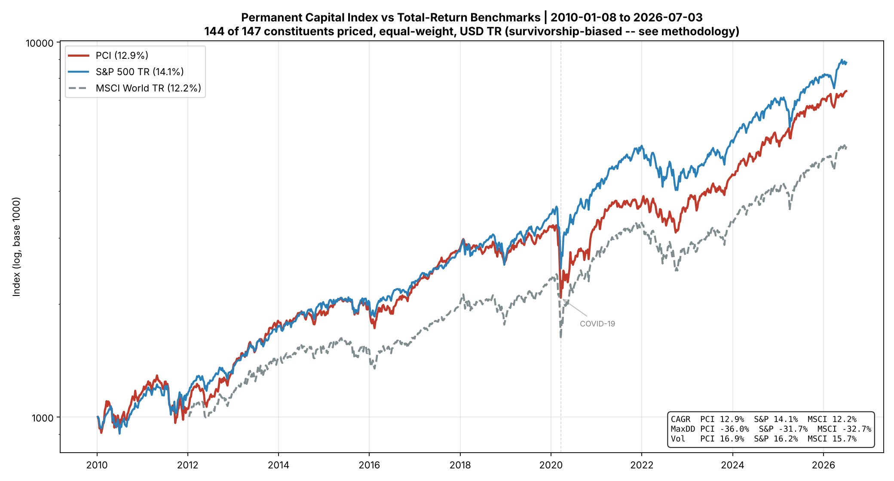

<!-- translation-of: README.md @ 95c67752bcc3de7e29d13e891b46bf654423fcc7 -->

# Permanent Capital Index™ (PCI)

[English](README.md) · **Français**

**Un indice de référence reproductible, aux règles ouvertement publiées, des *allocateurs de capital permanent* :
des sociétés cotées en bourse qui détiennent et réallouent du capital dans un portefeuille diversifié
d'actifs, financées par un capital sans droit de rachat et à horizon indéfini.**

**Simon Kreis & Claude.** Réalisé avec l'IA, principalement Claude (Anthropic), qui a contribué en partie ou en totalité au travail. Simon Kreis en est responsable. D'après une idée originale de Simon Kreis.

> Construit à partir de l'ADN de Berkshire Hathaway, de la sphère Wallenberg et des *sogo shosha*
> japonaises : permanence du capital, alignement des propriétaires et croissance composée sur plusieurs décennies,
> le tout sélectionné par **la structure, jamais par la performance passée**.

> **Version de référence (septembre 2026).** Chaque chiffre ci-dessous provient d'une seule exécution figée et
> reproductible, décrite dans [`AGENTS.md`](AGENTS.md) §5 ; deux constituants ne peuvent plus
> être évalués (§7.4). À des fins de recherche seulement ; ceci n'est pas un conseil en placement.

---

## Ce qui distingue le PCI

- **Sélectionné par la structure, pas par les rendements.** L'appartenance est décidée par une règle
  mécanique fondée sur le bilan, jamais par ceux qui ont surperformé. C'est délibéré : un indice qui sélectionne
  les gagnants ne peut pas servir honnêtement à soutenir que la catégorie gagne (voir la méthodologie, 2.1).
- **Équipondéré** : aucune domination des très grandes capitalisations.
- **Rendement total, en USD.**
- **Ascendant et reproductible** : n'importe quel tiers peut régénérer la liste des constituants à partir
  des règles publiées et de données publiques gratuites.

**Instantané actuel (juin 2026) :** 147 constituants répartis dans 26 pays. La pondération des États-Unis est d'environ 28 %
(contre plus de 60 % dans les indices mondiaux pondérés par la capitalisation) : une véritable diversification
géographique découle mécaniquement de la règle.

---

## Test rétrospectif honnête (2010-2026, rendement total, USD)

| | TCAC | Perte maximale | Volatilité | Sharpe |
|---|---|---|---|---|
| **PCI** | **12,9 %** | −36,1 % | 16,9 % | 0,68 |
| S&P 500 (rendement total) | 14,1 % | −31,7 % | 16,2 % | 0,77 |
| MSCI World (rendement total) | 12,2 % | −32,7 % | 15,7 % | 0,68 |

<sub>Exécution de référence : `--start 2010-01-01 --end 2026-06-30`, période effective 2010-01-08 → 2026-07-03,
145 des 147 constituants évalués (voir [AGENTS.md](AGENTS.md) pour savoir pourquoi 145 et comment reproduire le résultat).
Les chiffres changent si vous modifiez `--end` : fixez-le donc toujours.
Les données du MSCI World (approximé par URTH) commencent le 2012-01-13 ; ses chiffres couvrent 2012-2026, et non 2010-2026.</sub>



<sub>Exécution de référence, échelle logarithmique, base 1000. Les données du MSCI World (approximé par URTH) commencent le 2012-01-13 ; sa
courbe commence à cette date, ramenée à la base 1000, et ses chiffres couvrent 2012-2026, et non 2010-2026.</sub>

Le PCI se situe **entre** les deux indices de référence : à risque comparable, légèrement devant le MSCI World et derrière le
S&P 500, porté par les très grandes capitalisations américaines. **Il ne s'agit pas de revendiquer un alpha.** Le chiffre
comporte un **biais du survivant** à la hausse (les titres radiés de la cote ou disparus sont absents des données gratuites) ;
le vrai chiffre est donc probablement un peu plus bas. L'apport de ce projet est un indice de référence de catégorie
*reproductible et mesuré honnêtement*, pas un test rétrospectif qui bat le marché.
Voir la [méthodologie, §7](methodology/pci-index-methodology.md) pour l'ensemble des limites.

---

## La méthodologie en un écran

Un candidat est inclus s'il satisfait à **une seule règle mécanique uniforme** (aucun jugement au cas par cas) :

- **G1 (Permanence et durabilité) :** une société en exploitation (pas un fonds, un FNB, une BDC ni une SPAC),
  cotée depuis ≥ 3 ans.
- **G3 (Signature d'allocation) :** actifs de type placement (participations, entreprises associées comptabilisées
  à la valeur de consolidation, placements à long terme, portefeuilles d'assurance) ≥ 30 % de l'actif total, et
  immobilisations corporelles (PP&E) ≤ 33 %.
- **G5 (Investissabilité) :** capitalisation boursière ≥ 250 M USD.

Aucun critère de performance. L'alignement des propriétaires et la diversification détaillée sont des *attributs
publiés*, pas des filtres automatisés (les données gratuites sur l'actionnariat et les secteurs d'activité ne sont pas fiables). Le détail complet :
[`methodology/pci-index-methodology.md`](methodology/pci-index-methodology.md) ·
la justification : [`methodology/pci-theoretical-framework.md`](methodology/pci-theoretical-framework.md).

---

## Structure du dépôt

```
permanent-capital-index/
├── whitepaper/
│   ├── pci-whitepaper.md
│   └── pci-whitepaper.fr.md
├── methodology/
│   ├── pci-index-methodology.md       # canonical rules (single source of truth)
│   └── pci-theoretical-framework.md   # why the category should have an edge
├── scripts/
│   ├── universe_screener.py           # bottom-up structural screen (G1/G3/G5)
│   ├── simulator.py                   # equal-weight total-return backtest
│   ├── compare_countries.py           # per-country benchmark charts
│   └── requirements.txt
├── data/
│   ├── pci_candidate_universe.csv     # bottom-up candidate tickers
│   ├── pci_screened_v4.csv            # screen output (CONSTITUENT/REJECT + ratios)
│   ├── pci_constituents_v4.csv        # the 147 constituents
│   └── historical/pci_levels.csv      # backtest index levels vs benchmarks
└── charts/
```

---

## Démarrage rapide

```bash
pip install -r scripts/requirements.txt

# 1. Screen the candidate universe (structural, no performance gate). Resumable.
python scripts/universe_screener.py --universe csv:data/pci_candidate_universe.csv

# 2. The constituents are the CONSTITUENT-status rows of data/pci_screened_v4.csv
#    (saved as data/pci_constituents_v4.csv).

# 3. Run the honest, total-return backtest (equal weight, USD, semi-annual reconstitution).
#    Pin --end to a reconstitution date: without it the period runs to *today* and the
#    published figures above will not reproduce.
python scripts/simulator.py --start 2010-01-01 --end 2026-06-30
```

Pour élargir l'univers au-delà des candidats fournis, le filtre accepte aussi
`--universe sec` (tous les symboles américains via SEC EDGAR) et tout fichier de symboles `csv:` ;
l'exécution mondiale exhaustive se fait de préférence en local (son débit est limité par les données gratuites).

---

## Licence (modèle à la MSCI)

La méthodologie est **ouverte à dessein** ; la marque et les données officielles de l'indice sont protégées.

- **Méthodologie et documentation :** [CC BY 4.0](https://creativecommons.org/licenses/by/4.0/)
- **Code (`scripts/`) :** [MIT](https://opensource.org/licenses/MIT)
- **Nom « Permanent Capital Index » / « PCI » / logo :** marque de commerce. Les utiliser pour nommer ou
  commercialiser un produit financier exige une licence.

Voir [`LICENSE.md`](LICENSE.md). Ceci n'est pas un conseil en placement ; voir la méthodologie, §7, pour les limites.

Contact : Simon Kreis, M.Sc., [simon@kreisconsulting.ca](mailto:simon@kreisconsulting.ca).

---

*Inspiré par Warren Buffett et Berkshire Hathaway, ainsi que par les dizaines de sociétés de capital
permanent à croissance composée, négligées, dont le monde n'a jamais entendu parler.*
